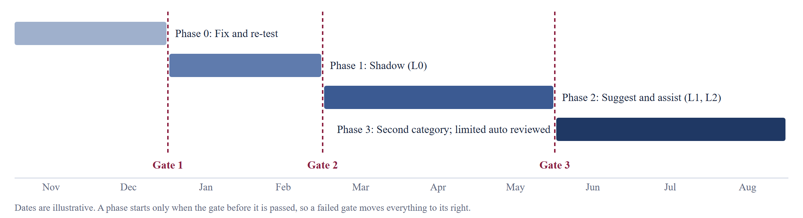
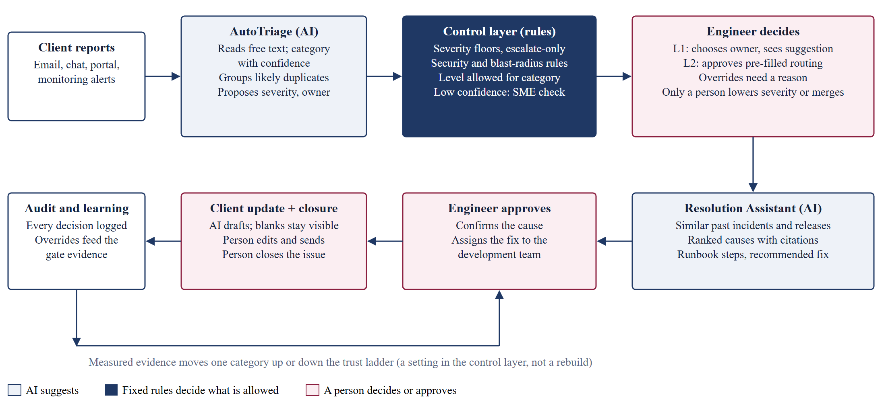
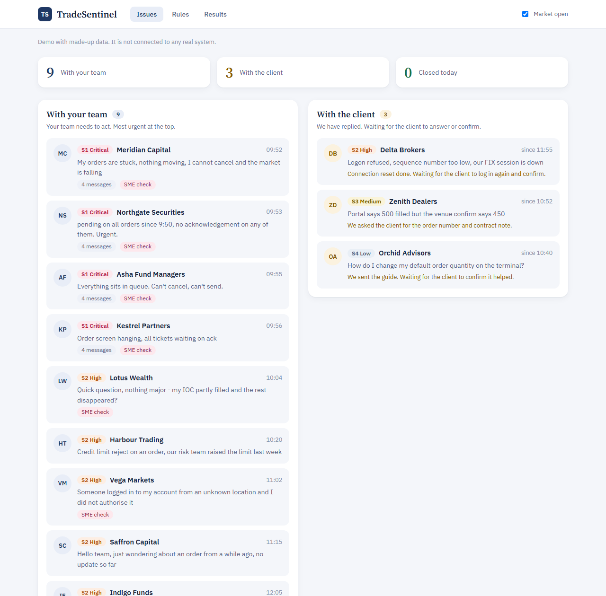
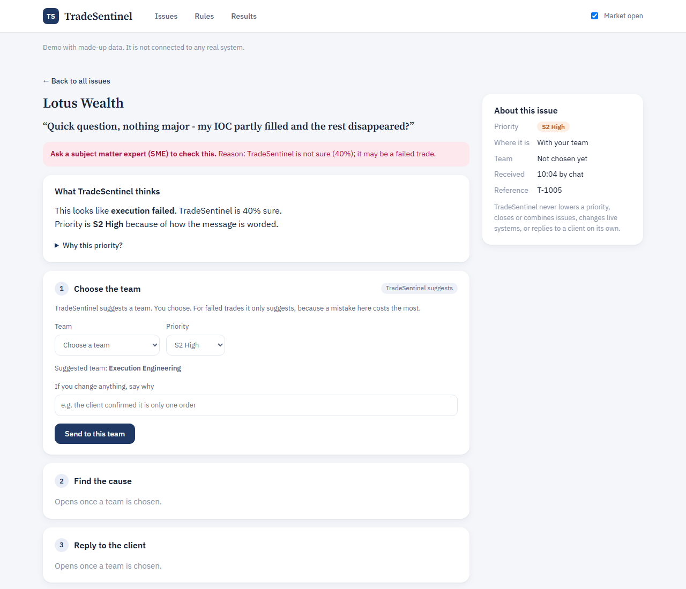
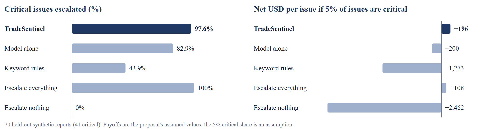
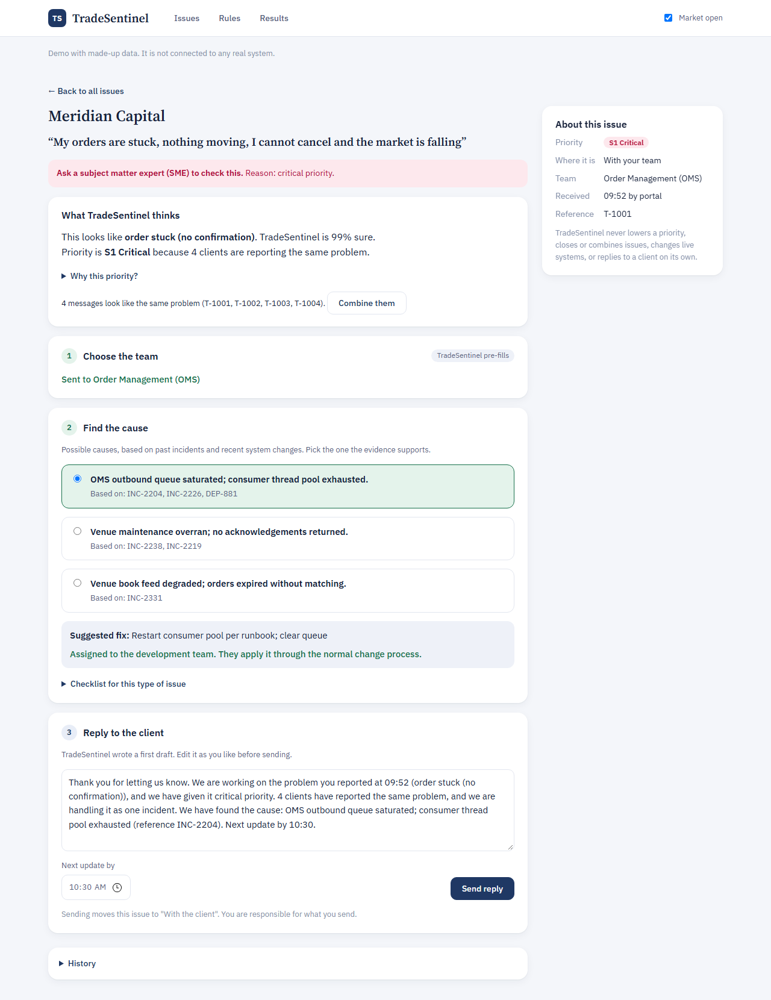

# Final Report on TradeSentinel

*Team013 (Individual) · Jodhdeep Singh · 2025mb26112 · MBA – AI in Business · Management of AI Products · November 2026*

## 1. Executive Summary

**Problem.** Technical issues reach a trading platform’s support team as free text, usually in the client’s own words. An engineer must work out what is broken, how serious it is and who owns it. Triage takes about 10 to 20 minutes per issue (assumed), the queue grows fastest in volatile markets, and one fault is often opened many times and worked separately. The costs are lopsided: a missed execution fault in market hours can cost far more than many needless escalations.

**Target user.** L1 and L2 support engineers on the order-entry and execution flow, with a subject matter expert (SME) as the point of escalation and the development team applying fixes. Clients benefit indirectly through faster, more accurate updates.

**Product.** TradeSentinel reads reports, proposes a category, severity and owner, groups likely duplicates, ranks causes with evidence, and drafts client updates. Fixed rules decide what is allowed: severity can only rise, every claim needs a citation, and automation is earned one category at a time.

**Why AI.** Reports are unstructured, reworded by every client and often understated. In our test, keyword rules classified 45.7% of reports correctly and a simple statistical model reached 90%. AI alone is still not enough: without the control layer, the same model escalated only 82.9% of critical issues, against 97.6% with it.

**Recommendation: pilot, in shadow mode only. Do not scale yet.** The working prototype supports the design but does not yet clear Gate 1. On 70 held-out synthetic reports it left three critical issues under-triaged, including one report that opened with “Not urgent”, and time saved cannot be measured without real users. We ask for approval to fix that weakness, re-test on fresh data, and then run eight weeks of silent shadow mode on one category set, with stop conditions set in advance.

## 2. Product Strategy

### 2.1 Product Vision

**Vision.** Every technical issue on the platform reaches the right engineer at the right severity within minutes, with the evidence attached, and no automation runs until the numbers have earned it.

**What TradeSentinel is.** A review copilot for the support desk. It reads, matches and drafts, while people decide. **What it is not.** It is not a client chatbot, not an autopilot that fixes production, and not a replacement for the SME on shift. These limits are part of the vision, not a temporary restriction: the trust ladder (Section 3.4) is how any automation is earned, category by category.

### 2.2 Jobs-to-be-Done (JTBD) Framework Across User Personas

Each persona below has a different job, and the product has to serve all of them without hurting any one. The primary job is the support engineer’s:

*When I am on shift and reports are arriving in clients’ own words during a volatile market, I want to know quickly which ones are the same fault, how serious each is and what probably caused it, so that I can protect clients from real losses without chasing every report by hand.*

| Persona | Job: when … I want … so that … | How it is done today | What the AI must respect |
|---|---|---|---|
| L1/L2 support engineer (primary) | When reports pile up in market hours, I want a clear reading, priority and owner for each, so that I act on the right one first. | Reads every ticket; searches old tickets; asks colleagues on chat | Show why it thinks so; never leave the engineer blamed for a hidden AI error |
| Subject matter expert (SME) | When an unclear or high-risk issue reaches me, I want the evidence already gathered and only real escalations, so that I can judge fast and return to my own work. | Pulled in by chat or phone; re-asks basic questions | Escalations carry a reason; SME load is watched so that it does not cause alert fatigue |
| Development team | When a fix is assigned to us, I want a confirmed cause, the evidence and a suggested fix, so that we can apply it safely through the change process. | Receives vague tickets and reconstructs the cause | The system never deploys or rolls back; fixes go through the normal change process |
| Operations and risk lead | When I decide how much to automate, I want evidence per category and a quick way back, so that SLAs improve without unmeasured risk. | Monthly reports and post-incident reviews | Automation levels are per category, evidence-gated and reversible by configuration |
| Client (indirect) | When my order looks stuck, I want a timely and accurate update, so that I can manage my position. | Calls or emails repeatedly | No invented cause is ever sent; a person approves every reply |

*Personas are reasoned from my proposal and how a support desk works. No user interviews have been held yet; Phase 0 tests them.*

### 2.3 Opportunity Framing - Why Now and Why Alternatives Fail

- **Why this problem matters.** The decision repeats on every ticket, its cost is measurable, and the downside is severe. By the proposal’s illustrative payoffs, one missed critical issue costs as much as about 333 needless escalations.
- **Why AI may help.** The hard step is reading unstructured language and matching it to past incidents, which language models do well and cheaply. What AI does poorly here is knowing when it is wrong, so hard limits stay in rules.
- **Why now.** Language models can now read free text through an API at about USD 0.05 per ticket (Section 6), far below the cost of engineer time, which removes the old need for a large labelled dataset before any trial can start. Trading volumes are also more volatile, so the queue spikes exactly when mistakes are most expensive.

| Alternative | Why it falls short | Evidence |
|---|---|---|
| Keyword rules | Break on reworded and understated reports | Measured: 45.7% category accuracy and 43.9% critical recall on the holdout |
| AI model with no control layer | Misses critical issues that are worded calmly | Measured: 82.9% critical recall; −200 USD per issue at 5% critical |
| Escalate everything | Swamps SMEs, and loses money when critical issues are rare | Measured: −98 USD per issue at 1% critical |
| Hire more engineers | Scales cost, not consistency; quality still depends on who is on shift | Reasoning |
| Dashboards and monitoring | Show machine signals but do not read client language | Reasoning |
| Better runbooks | Help only after someone has identified the problem correctly | Reasoning |
| Client-facing chatbot | Does not touch the triage decision that causes the losses | Reasoning |

### 2.4 AI Opportunity Matrix and RICE Feature Prioritization

The matrix decides which ideas are in scope; RICE then orders the features inside that scope.

| Idea | Business value | Feasibility | Priority | Decision and reason |
|---|---|---|---|---|
| Triage with severity floors | High | High | High | First. This is the core decision loop. |
| Duplicate clustering | High | High | High | First. It also feeds blast-radius severity. |
| Cause ranking with evidence | High | Medium | Medium | MVP in simple form. Needs real incident history to prove value. |
| Client update drafting | Medium | High | Medium | MVP, always behind human approval. |
| Auto-routing low-risk issues (L3) | Medium | Medium | Low for now | Later. Must be earned through the gates. |
| Autonomous fixes in production | High | Low | Rejected | One bad action could outweigh a year of savings. |
| Client-facing chatbot | Low | Medium | Rejected | Does not touch the decision that causes the losses. |

RICE ranks the options, but the control layer sits above it: it is a precondition for launching, so it is not scored. Reach is issues per quarter at an assumed 3,000; impact, confidence and effort are my judgement.

| Feature | User value | Effort (person-months) | Confidence | RICE | Priority |
|---|---|---|---|---|---|
| Control layer and audit log | Critical | 2 | High | Not scored | Must have |
| Classification + severity | High | 2 | 80% | 2,400 | MVP |
| Duplicate clustering | High | 1 | 70% | 1,680 | MVP |
| Runbook guidance | Medium | 1 | 80% | 800 | MVP |
| Cause ranking with evidence | High | 3 | 60% | 600 | MVP, simple form |
| Client update drafts | Medium | 1.5 | 70% | 467 | MVP |
| L3 auto-routing | Medium | 3 | 30% | 80 | After Gate 3 |

### 2.5 Build vs. Buy vs. Partner or API Decision

**Recommended path: API-first for the commodity parts; build only the control layer.** Learning speed matters more than model ownership at this stage.

| Component | Choice | Why | Main trade-off |
|---|---|---|---|
| Language model | API | Good enough to test the workflow; no training data needed | Vendor risk and data handling; needs an approved private route |
| Search over incidents | Buy or existing tool | Commodity; no differentiation | Quality depends on the incident records |
| Ticketing | Keep existing | Engineers will not move to a new queue tool | Integration work |
| Control layer | Build | Depends on our own SLAs and market-hours rules; must be auditable | We own its maintenance |
| Evaluation and audit | Build | Gate decisions depend on it and it must be trustworthy | Ongoing effort from the team |

**Platform vs feature.** TradeSentinel starts as a feature inside existing support tooling. It becomes a platform only if new categories can be added as configuration. The reuse test in Section 8.2 addresses this directly; if it fails in practice, the product stays an assist feature, as the proposal committed.

### 2.6 First Wedge Selection & Course Case Lens Comparative Analysis

**Chosen wedge:** order-entry and execution issues for one client tier on one venue. Choosing the riskiest flow first is deliberate: if the controls hold here, they are likely to hold in easier flows; the reverse is not true.

| Candidate wedge | Cost of error | Language variety | Verdict |
|---|---|---|---|
| Order entry and execution | Highest: client losses in market hours | High | **Chosen.** Proves the controls where they matter most. |
| Market data feed delay alerts | High: one fault hits many clients | Low: machine-generated alerts | Second category, used as the reuse test (Section 8.2). |
| Post-trade and position mismatch | Medium | Medium | Later phase. |
| Access and how-to questions | Low | High | Rejected as first: easy wins, but proves nothing about safety. |

| Case | What is similar | What is different | Lesson we applied | What we would do differently |
|---|---|---|---|---|
| Netflix (metrics and evaluation) | A model metric only matters if it moves a business outcome | Errors here carry financial and regulatory cost; a poor recommendation does not | Judge decisions by net payoff, not accuracy (Section 5.5) | Weight rare critical errors heavily instead of averaging them away |
| Instacart (lifecycle and drift) | Volatile periods change behaviour and can break patterns learned in calm periods | Our data shift arrives within minutes during a market event | Floors do not depend on the model, so they still hold when it drifts | Monitor separately by market regime |
| Apple Card (bias and governance) | “The model decided” is not an acceptable answer to an affected client or regulator | We rank internal support work; we do not decide credit | Every severity step shows its reason and is logged | Test fairness across client size and language before launch |
| iMerit (data operations and labeling) | Model quality is capped by label quality | Our labellers are scarce SMEs, not a large workforce | Double labelling with adjudication (Section 5.3) | Label a small, well-chosen sample instead of everything |

*Case points are drawn from general knowledge of these cases and should be checked against the course case notes.*

## 3. Product Management (PM) Artifact Pack

The full PRD, roadmap, metrics and risk documents are in the Appendix. This section gives the summary and the decisions behind them.

### 3.1 Problem Statement & Product Vision

**Problem statement.** Support engineers on the order flow make a repeated triage decision from unstructured client language under time pressure. Today that decision is slow (10 to 20 minutes, assumed), inconsistent across shifts, and worst during volatile markets, when under-calling a real fault is most expensive. The decision being improved is: *what is this, how serious is it, is it the same as another report, and who owns it?*

**Product vision (future state).** An engineer opens the board and sees two lists: what needs the team now, and what is waiting on a client. Each issue already carries a reading, a priority with its reasons, likely duplicates and evidence-backed causes. The engineer decides; the SME checks what is unclear or risky; the development team receives a confirmed cause with the fix. Automation grows only where measured results allow it.

### 3.2 User Personas & AI-Aware User Stories

| User | Context | Needs | Error cost they carry |
|---|---|---|---|
| L1/L2 support engineer | Handles the queue during market hours, under time pressure | Clear reading of the report; quick routing; no blame for hidden AI errors | A missed fault; a wasted hour on the wrong path |
| Subject matter expert (SME) | Checks unclear, failed-trade, security and critical issues | Only real escalations; full evidence on arrival | Alert fatigue if over-escalation is high |
| Development team | Applies approved fixes through the change process | A clear cause, evidence and suggested fix | Rushed or wrong fixes in production |
| Operations and risk lead | Owns SLA and automation decisions | Evidence for gates; audit trail; quick rollback | Reportable events; regulatory exposure |

| ID | Story | Acceptance criteria |
|---|---|---|
| US1 | As an engineer, I see the AI’s reading, its confidence and alternatives. | Category, confidence and next-best options are shown on every ticket above L0. |
| US2 | When the system is unsure, I want to see that and have an SME check it. | Below 55% confidence: “unsure” marker, strictest plausible floor, SME check. |
| US3 | I want to see why severity is what it is. | A severity trail lists each step and reason. |
| US4 | I want duplicate reports grouped without losing control. | Suggested group shown; merging needs a person; blast radius can raise severity. |
| US5 | I want to disagree and have that count. | Every change requires a reason, which is logged. |
| US6 | I want likely causes with proof. | Each cause lists at least one past incident or release. |
| US7 | I do not want to send a client something unproven. | The draft can be edited; Send is locked while any blank remains; no cause appears without a citation. |
| US8 | As a risk lead, I want to change automation without a release. | Levels are set per category in configuration; rollback is immediate. |
| US9 | As an engineer, I want to see at a glance which issues need me and which are waiting on the client. | Home board has two lanes; sending an update moves an issue to the client lane; a client reply moves it back. |

### 3.3 Product Requirements Document (PRD) Summary

| Element | Summary |
|---|---|
| User problem | Reading, sizing and routing reports takes too long, and the riskiest reports can be the least clearly worded. |
| Core workflow | Report arrives; AI proposes category, severity, owner and duplicates; rules apply floors and limits; engineer decides; AI ranks causes with evidence; engineer confirms the cause and assigns the fix to the development team; AI drafts the reply; engineer edits it if needed and sends it, and the issue waits in the client lane until the client replies; engineer closes. |
| AI role | Classification, severity proposal, similarity matching, cause ranking and drafting. It suggests and never commits. |
| Data assumptions | Past incidents hold usable cause and fix notes; expert labels can be collected; release records carry timestamps. All unverified until pilot. |
| Risks | Under-triage of understated reports; rubber-stamp approvals; invented causes in client updates; prompt injection through ticket text. |
| Fallback logic | Below the confidence threshold: strictest plausible floor plus an SME check. Model unavailable: the manual queue works as it does today, with floors still applied by rule where the category is known. |
| Never allowed | Downgrade severity; close or merge an issue; deploy or roll back in production; send an unapproved update; state an uncited cause. |

*Full PRD with functional requirements and control configuration: Appendix/PRD.*

### 3.4 Smallest Credible MVP Definition & Staged Roadmap with Proof Gates

**MVP.** One flow, in which a person can see the AI’s reading, see why severity was set, make the decision, and get evidence-backed resolution help up to an approved client update. The MVP has succeeded if it answers three questions: Does the AI read reports better than rules? Do the controls catch what the AI misses? Does an engineer understand and trust the decision trail? The prototype addresses the first two on synthetic data; the third needs real users.

**Trust ladder.** L0 Shadow (runs silently), L1 Suggest (shows suggestions; person decides), L2 Assisted (pre-fills for one-click approval), L3 Limited auto (low-risk, reversible actions only). Levels are set per category and must be earned.

*Figure 1. Each phase is entered only by passing a gate. Full gate criteria are in Appendix/Roadmap.*

| Phase | Question it answers | Autonomy | Gate to leave |
|---|---|---|---|
| 0. Fix and re-test (Nov to Dec 2026) | Can we close the understated-report gap? Does the design save time? | None | Gate 1 |
| 1. Shadow (Jan to Feb 2027) | Does it work on real tickets, for all client groups? | L0 | Gate 2 |
| 2. Suggest and assist (Mar to May 2027) | Do engineers use it well? Is net payoff positive? | L1, then L2 | Gate 3 |
| 3. Second category (Jun to Aug 2027) | Is the design reusable? Should anything be automated? | L0 for new; L3 reviewed | Reuse decision |

### 3.5 Success Metrics & KPIs Framework

**North star:** critical issues reach the right team at the right severity, quickly. Every other measure either drives it or guards against a side effect.

| Layer | KPI | Today | Target | Leading or lagging |
|---|---|---|---|---|
| Model | Category accuracy | 90% (synthetic) | Clearly above rules on real tickets | Leading |
| Model | Calibration error (ECE) | 0.083 | Below 0.05 before L2 | Leading |
| Product | Time to first correct triage | 10 to 20 min (assumed) | Under 3 minutes | Leading |
| Product | True cause in top 3 | 96.8% (synthetic) | At least 70% | Leading |
| Business | Net payoff per issue against current practice | +196 USD (assumed payoffs) | Positive before any level change | Lagging |
| Business | SLA breaches on S1/S2 issues | Not tracked | Falling | Lagging |
| Trust | Critical issues under-triaged | 3 of 41 | Near zero | Guardrail |
| Trust | Override rate and median review time | Not measured | Stable; falling review time with steady errors means rubber-stamping | Guardrail |
| Trust | Share sent to SME check | 34.3% (synthetic) | Sustainable for the SME team | Guardrail |

*Metric definitions and full results: Appendix/Metrics.*

### 3.6 How PM Artifacts Change When the Product Is AI-Powered (Section 8 Requirement)

| Artifact | What changed in TradeSentinel |
|---|---|
| Problem statement | Names the decision being improved, not only the pain. |
| User story | Includes uncertainty and error cost: “When the system is unsure, I see why and it asks an SME to check.” |
| PRD | Adds data assumptions, confidence behaviour, fallback logic and a list of actions never allowed. |
| Roadmap | Organised around proof gates with stop conditions, not feature delivery dates. |
| Metrics | Links model measures (recall, calibration) to dollars through the payoff matrix. |
| Launch checklist | Adds review, rollback of autonomy, and escalation (Appendix/Risk_Note). |
| Pricing note | Includes inference and review cost per issue (Section 6). |
| Review memo | Separates measured results from assumptions (Section 10.2). |

**How AI helped create these artifacts, and what stayed with me.** The packet asks for both to be visible.

| PM task | What the AI assistant did | What I decided |
|---|---|---|
| Drafting PRD structure | Turned my proposal into a PRD layout and user stories | Scope, non-goals and the never-allowed list, which come from my proposal |
| Prioritization alternatives | Computed RICE scores on stated assumptions | The priority order follows my proposal: controls and triage first, automation only after the gates |
| Wireframe starting points | Produced the first console layout | Judged it too crowded and set the two-lane, three-step design |
| Prototype coding | Wrote the code, synthetic data and test harness | The roles (SME, development team), editable replies and plain wording |
| Scenario analysis | Calculated the conservative, base and optimistic cases | The payoff values from my proposal, and the recommendation after reviewing the results |

## 4. UX, Workflow & Trust Design

### 4.1 Core UX Principle - A Review Copilot, Never an Autonomous Controller

The system should feel like a careful colleague who shows their working, not like an autopilot. AI output here is probabilistic, so the interface shows doubt openly instead of hiding it. It should also be calm under pressure: the home board answers one question, who must act next, and everything else is one click away. Labels use plain words, such as “Choose the team” and “Reply to the client”, so a new engineer can follow it without training.

- **Suggest, never commit:** every action that matters needs a person.
- **Show the reason with the answer:** confidence, alternatives and the steps that set priority.
- **Slow down where errors are costly:** at L1, nothing is pre-filled, so the engineer must choose.
- **Fail safe:** when unsure, raise priority and ask an SME; never lower it.

### 4.2 End-to-End User Journey & Workflow Comparison (As-Is vs. To-Be)

*Figure 2. The AI reads and matches, rules set the limits, and a person makes every decision that matters.*

| Step | As-is (today) | To-be (with TradeSentinel) |
|---|---|---|
| Intake | Email, chat, portal and alerts arrive separately | One queue; each report read on arrival |
| Understand | Engineer reads and interprets each report | AI proposes the category with confidence and alternatives |
| Size | Priority depends on who is on shift | Model proposal, then floors, security and blast-radius rules; priority can only rise |
| Duplicates | Same fault opened and worked many times | Likely duplicates grouped; a person confirms the merge |
| Route | Engineer finds the owner | Owner suggested (L1) or pre-filled (L2); unclear or risky issues go to an SME |
| Investigate | Search logs, releases and old tickets by hand | Causes ranked with cited incidents and releases |
| Fix | Depends on the engineer’s memory | Checklist and suggested fix; fix assigned to the development team |
| Update client | Written from scratch under pressure | Editable draft; Send locked while blanks remain |
| Wait and close | Waiting issues get lost among active ones | Separate client lane; a person closes with a cited note |

### 4.3 Annotated Wireframe & Screen Architecture

| Screen | Purpose | Main elements |
|---|---|---|
| Top bar | Navigation and context | Issues, Rules and Results tabs; Market open switch |
| Issues board | Who must act next? | Three counts; lanes “With your team” and “With the client”; Try your own message; Closed today |
| Issue page | Decide on one issue | Step 1 Choose the team; Step 2 Find the cause; Step 3 Reply to the client; side card “About this issue” with “Why this priority?” and history |
| Rules | Set automation per category | Level per category; execution failures locked at L1; paper reuse test |
| Results | Show the evidence | Evaluation results, where it went wrong, money view by approach |

Low-fidelity wireframes with design notes are in Appendix/Wireframes. The screens below come from the working prototype, simplified after the first version proved too crowded.

**Home board.** *With your team* holds issues that need support action, most urgent first. *With the client* holds issues where an update has gone out and the client must reply or confirm, each showing what is awaited and since when. Issues that need expert judgment are flagged “SME check”.

*Figure 3. Home board. The four linked stuck-order reports lead the team lane at S1; three issues wait on clients.*

*Figure 4. “Quick question, nothing major”: one issue, three steps. Low confidence asks an SME to check, and with execution failures held at L1 nothing is pre-filled.*

### 4.4 Trust, Explainability, and Information Hierarchy (Visible vs. Hidden)

| Question | Design decision |
|---|---|
| What does the user need to know? | What the AI thinks, how sure it is, what else it could be, why severity is what it is, and what the evidence is. |
| What must be visible? | Confidence, alternatives, each step that raised severity, the automation level, citations, unfilled blanks, and the actions that are never allowed. |
| What should be hidden? | Raw model scores and token-level detail, which add noise under pressure. In L0 all suggestions are hidden, so that shadow data is not contaminated. |
| What sits one click away? | The full severity trail, alternatives, checklist and history sit behind “Why this priority?” and similar toggles, so the board stays readable and nothing is lost. |

### 4.5 Uncertainty Handling & Fallback Behavior Matrix

| Situation | System behaviour | Human role |
|---|---|---|
| High confidence | At L2, routing is pre-filled for one-click approval, with reasons on screen. At L1, shown as a suggestion. | Engineer approves or overrides with a reason |
| Low confidence (below 55%) | Marked “unsure”. The strictest floor of any plausible category applies. | SME checks |
| Possible execution failure or security event | SME check regardless of confidence; execution failures stay at L1; security also goes to the security team. | SME and security decide |
| Several reports of one fault | Grouped; three reports set at least S2, four in market hours set S1. | Engineer confirms the merge |
| No evidence for a cause | The assistant says so; the reply keeps a visible blank and Send stays locked. | Engineer investigates |
| Model down or slow | Ticket drops to the manual queue, marked “no AI reading”; rule floors still run. | Engineer works as today |
| Metric breach in a category | The category drops a level by configuration, at once. | Operations lead confirms |

**Human in the loop.** Engineers decide owner and priority, give a reason for any override, approve merges and the cause, and edit and send every reply. Fixes are assigned to the development team. Review time is logged and approvals are sampled, to guard against rubber-stamping.

### 4.6 Accessibility & Ergonomic Considerations for Support Engineers

Support engineers work long shifts, often at night, across several screens and under time pressure. The design treats attention as the scarce resource.

| Consideration | In the prototype today | Planned for the pilot |
|---|---|---|
| Cognitive load | One question per screen; detail behind expandable sections; plain-language labels | Timed trial with five engineers to confirm the three-step flow |
| Colour | Priority shown as words and code (“S1 Critical”), not colour alone | Contrast audit against WCAG 2.2 AA |
| Keyboard and screen readers | Native buttons and expandable sections; visible focus outline; tabs and fields labelled for screen readers | Screen-reader test; keyboard shortcuts for high-volume triage |
| Night shifts and comfort | Follows the system dark mode; respects reduced-motion settings | Check readability on desk monitors and multi-screen setups |
| Fatigue and rubber-stamping | L1 forces a choice; Send locked while blanks remain | Review time tracked as a fatigue signal; seeded test cases |
| Shift handover | Client lane shows what is awaited and since when | Handover summary per shift |

## 5. Data, Model & Evaluation Strategy

### 5.1 Translation of Business Problem into AI

The business question “what is this, how serious is it, and who owns it?” becomes a set of narrow AI tasks, with the riskiest decision kept in rules.

| Sub-task | AI task | Prototype | Pilot plan |
|---|---|---|---|
| Category | Multi-class classification | Naive Bayes on words and word pairs | API language model, structured output |
| Severity proposal | Ordinal classification | Naive Bayes | API language model |
| Severity limits | Rules (no AI) | Control layer | Same control layer |
| Duplicates | Similarity with time window | TF-IDF cosine within 30 minutes | Embeddings plus time window |
| Likely cause | Retrieval and ranking | TF-IDF over past incidents, release boost | Embeddings and citation checks |
| Update drafts | Constrained generation | Templates with slots | Language model with citation checks |

### 5.2 Data Sources, Readiness Assumptions, and Privacy Pre-Processing

| Source | Type | Readiness (assumed) | Main risk | Action before pilot |
|---|---|---|---|---|
| Tickets and resolution notes | Internal | Exists; quality varies | Short or missing cause notes | Sample 200 and grade them |
| Incident records | Internal | Exists for major incidents | Minor incidents not recorded | Agree a minimum record format |
| Release logs | Internal | Exists with timestamps | Component names inconsistent | Map names to owning teams |
| Runbooks | Internal | Partial | Out of date | Owner review per category |
| SLAs and market-hours calendar | Internal | Exists | Holidays and half days | Load into control configuration |
| Venue circulars and status notices | External | Public | Arrive late | Use as supporting evidence only |
| Engineer overrides and reasons | User-generated | Created by the product | Noisy and inconsistent | Audit a sample monthly |

*Readiness is assumed until checked in Phase 0. Prototype data is entirely synthetic: 108 training reports, 90 test reports, 23 past incidents and 4 releases, with no real client, order or firm data.*

**Privacy pre-processing (planned for the pilot, not built in the prototype):**

1. Tickets are received inside the firm’s boundary, and rules that need raw text (security terms, market hours) run there first.
2. Identifiers are masked: client names, account and order numbers, amounts and positions, emails and phone numbers become typed tokens such as [ACCOUNT_1].
3. Only masked text goes to the language model API, over an approved private route with no-training and retention terms.
4. Results are re-linked to the real identifiers inside the boundary; logs keep the masked version, with role-based access.
5. Masking is tested before Gate 2; any failure is a launch blocker.

### 5.3 Labeling & Ground Truth Strategy (Applying the iMerit Case Lens)

The iMerit lens says that labelling quality is an operations discipline: trained domain experts, written guidelines, several quality passes and measured agreement. Applied to TradeSentinel:

| Practice | How TradeSentinel applies it |
|---|---|
| Domain experts, not crowd labour | SMEs label, because severity in trading needs market knowledge. |
| Written guidelines | A labelling guide defines each category and severity, judged on what was known at the time, to avoid hindsight bias. |
| Double labelling and adjudication | Two SMEs label each sampled ticket independently; a third resolves disagreements. |
| Measured agreement | Expert-to-expert agreement sets the model’s ceiling: if experts agree on 85%, a higher target is meaningless. |
| Gold set | Seeded cases with known answers, including understated reports, are used to audit labellers and the model. |
| Continuous labels | Engineer overrides become new labels, but are treated as noisy and sampled before use. |

**What is different.** iMerit-style operations work at scale; our labellers are scarce SMEs, so we label a small, well-chosen sample weighted towards critical and understated reports. In the prototype, labels were assigned when the synthetic data was written.

### 5.4 Baseline and Model Choice

The baseline is a keyword rule set that a capable team could write in an afternoon; if AI cannot clearly beat it, the case for AI fails. The prototype uses a local classifier rather than a language model so that every run is repeatable, free and needs no client data to leave the machine. **This means the prototype tests the workflow and control logic, not language model quality.** Confidence is scaled using a temperature value chosen by cross-validation on the training data only.

### 5.5 Evaluation Framework and Results

Settings were tuned on a 20-report development set, then frozen. The 70-report holdout set, which includes deliberately understated, polite and very short reports, was run once on those frozen settings. Results below are reproducible with *node evaluate.js holdout*. Holdout results were not used for tuning.

| Metric type | Metric | Result (holdout) | Baseline or target | Why it matters |
|---|---|---|---|---|
| Technical | Category accuracy | 90% (63 of 70) | Keyword rules 45.7% | Wrong category means wrong owner and wrong floor |
| Technical | Macro F1 | 0.899 | Keyword rules 0.486 | Guards against a strong category hiding a weak one |
| Technical | Calibration error (ECE) | 0.083 | Lower is better | L2 depends on confidence meaning something |
| Technical | Duplicate pairs: precision / recall | 100% / 100% | High | Likely flattered by clean time bursts in our data |
| Technical | True cause in top 3 / top 1 | 96.8% / 80.6% | At least 70% in top hypotheses | Likely flattered: same author wrote incidents and tests |
| Trust | Critical issues escalated | 97.6% (40 of 41) | Model alone 82.9% | 95% interval is 87.4% to 99.6%; sample is small |
| Trust | Under-triaged critical issues | 3 (1 fell below escalation) | Near zero | **Target not met** |
| Trust | Wrong category sent to SME check | 5 of 7 | All | Two errors passed at high confidence |
| Trust | Guardrail invariants | 5 of 5 held | All, on every ticket | Severity never lowered; no unapproved or uncited send |
| Business | Net payoff per issue, 5% critical | +196 USD | Model alone −200 | Assumed payoffs, measured error rates |
| Business | Time to first correct triage | Not measured | Under 3 minutes | Needs real users; no value claimed |

*Figure 5. The control layer raises critical-issue escalation and turns a losing payoff into a positive one.*

**What the comparison shows.** At the assumed payoffs, the model alone loses money because each extra miss is so expensive: it missed seven critical issues where TradeSentinel missed one. Escalating everything is a surprisingly strong competitor when critical issues are common (+365 against +378 USD at a 10% share), but far worse when they are rare (−98 against +50 at 1%). The real critical share is therefore a number the pilot must measure.

**Where it failed.**

| Report | Truth | System | Reading |
|---|---|---|---|
| “Not urgent, but my limit order that should have traded at the touch shows nothing done.” | S2 | S3 | The most serious failure. Polite framing and thin vocabulary produced a wrong category at 82% confidence, so neither floors nor the SME check fired. |
| “All sessions dropped at 9:15 for our firm, can't reconnect.” | S1 | S2 | Escalated, but below critical: only three reports had arrived, one short of the blast-radius rule. |
| “Gateway unreachable, market is open and we are blind.” | S1 | S2 | Same cluster, same reason. |

Very short messages can also score high confidence on little evidence: “Getting error 2047 when I enter” receives 95% in the demo. Two proposed fixes follow, neither yet applied or tested: a rule that sends any report mentioning an order with no visible outcome to the execution floor, and a confidence cap on reports with few recognised terms. They need a *new* held-out set, because the current one has now been seen.

**How far to trust these numbers.** One author wrote the training data, test data and incident catalogue, so the shared vocabulary probably flatters every figure, and the 100% clustering result should not be taken at face value. What the evaluation can show is that the logic works and where it breaks. It cannot show how the system performs on real tickets.

### 5.6 Launch Thresholds and Gate Status

| Gate | Requirement | Status today |
|---|---|---|
| Gate 1: Synthetic | Targets met on synthetic data: root cause at least 70%; under-triage near zero; time under 3 minutes in a user trial | **Partly met.** Root cause met. Under-triage not met. Time not yet measured. |
| Gate 2: Shadow | 8 weeks on real tickets: category agreement within 5 points of expert-to-expert agreement; no S1 issue called below S2; no critical issue below the escalation line, including replayed past incidents | Not started |
| Gate 3: Live assist | Positive net payoff against current practice; calibration error below 0.05; stable review time and override rate; operations and risk sign-off | Not started |

**Sample size matters.** Zero misses in n cases only shows a true miss rate below about 3/n, so about 300 critical cases are needed to claim under 1%. Live shadow volume alone will not provide that in eight weeks, so Gate 2 also replays historical critical incidents.

## 6. Business, Economics & Scaling

All amounts here are illustrative assumptions, set out so that they can be challenged and replaced with real figures during the pilot.

### 6.1 Monetization Model and Value Logic

**Internal value case.** TradeSentinel is funded as an operating and risk investment, not sold. External licensing is out of scope until reuse is proven; our control logic depends on one firm’s SLAs and may not transfer directly.

- **Time:** faster triage and resolution, and fewer duplicate tickets worked separately.
- **Risk:** fewer critical issues missed or under-called, the largest and least certain value.
- **Consistency:** quality depends less on who is on shift.

### 6.2 The Economics of Being Wrong

Escalating is the better decision whenever the chance that an issue is critical exceeds the break-even share below. The conclusion survives large changes in the inputs: the break-even stays low, so the design should continue to lean towards escalation.

| Scenario | False escalation (USD) | Missed critical (USD) | Break-even critical share |
|---|---|---|---|
| Proposal values | 150 | 50,000 | 0.34% |
| False escalation costs USD 500 | 500 | 50,000 | 0.97% |
| A miss costs USD 10,000 | 150 | 10,000 | 1.25% |
| Both of the above | 500 | 10,000 | 3.47% |

*Correction to the proposal.* The proposal described a false escalation as wasting “a few minutes” but priced it at USD 150. That figure only makes sense if it includes interrupting an SME and possibly opening a bridge. We keep USD 150 as the more cautious value, because it works against our own case, and test USD 500 above.

### 6.3 Cost Drivers

| Driver | Assumption | Per issue or per month |
|---|---|---|
| Model / API | 11,000 input and 1,100 output tokens per issue, at an assumed USD 3 and USD 15 per million | About USD 0.05 per issue (USD 0.10 with retries) |
| Review | Engineer still reviews every decision; netted against time saved | Included in time saved |
| False escalations | 13.8% of minor issues (measured, synthetic), 95% of issues minor, USD 150 each, less the human baseline rate (unknown; 0% to 10% assumed) | USD 5.42 to USD 19.67 per issue |
| Run and maintain | 0.5 FTE for evaluation, prompts and config, plus hosting and logging | USD 7,000 per month |
| Pilot build | Two engineers for three months at an assumed USD 60 per hour | About USD 60,000 once |

### 6.4 Unit Economics

| Per issue, at 1,000 issues a month | Conservative | Base | Optimistic |
|---|---|---|---|
| Time saved (at assumed USD 60 per hour) | USD 7 | USD 30 | USD 40 |
| Inference | −USD 0.10 | −USD 0.05 | −USD 0.05 |
| Extra false escalations | −USD 19.67 | −USD 12.54 | −USD 5.42 |
| Run and maintain | −USD 7.00 | −USD 7.00 | −USD 7.00 |
| **Net per issue, before avoided misses** | **−USD 19.77** | **USD 10.41** | **USD 27.54** |
| Net per month | −USD 19,765 | USD 10,410 | USD 27,535 |
| Payback on pilot build | None from time alone | 5.8 months | 2.2 months |

**What this means.** Inference is a rounding error. False escalations are not: they can consume more than the time saved. Time savings alone may therefore not justify the product. In the conservative case the shortfall is USD 19,765 a month, which one avoided critical miss about every 2.8 months would cover (a miss turned into a catch is worth USD 55,000 at the assumed payoffs). The case therefore rests on risk reduction, which is why that is what the pilot must measure.

**Volume matters.** In the base case, contribution before fixed cost is USD 17.41 per issue, so break-even is about 403 issues a month: at 300 a month the result is −USD 5.92 per issue; at 3,000 it is USD 15.08. A very small desk may be better served by runbooks and rules.

### 6.5 Scaling Risks and Operational Implications

| Risk | What happens | Response |
|---|---|---|
| Latency | Peak load coincides with market stress, exactly when API latency and rate limits may bite | Rules run locally and first; a queue with a time limit falls back to the manual path |
| Cost growth | Alert storms multiply inference calls | Cluster before calling the model; per-incident budgets |
| Workflow complexity | Every category adds floors, owners and runbooks | Add a category only with a named owner; retire unused rules |
| Governance burden | Each level change needs evidence and sign-off | Automated gate reports; quarterly review |
| Team effects | Juniors may lose triage skill; SMEs may get more escalations | Rotate triage without AI; watch SME load as a guardrail |

## 7. Ethics, Governance & Risk

The full risk register and launch checklist are in Appendix/Risk_Note.

### 7.1 Main Risks and Controls

| Risk | Specific form in TradeSentinel | Control |
|---|---|---|
| Bias | Polite or non-native wording, or smaller clients with thin history, may get lower severity. Our holdout miss shows understated language is a real weak spot. | Fairness test across client size and writing style before Gate 2; floors ignore client identity; no client tier feature in severity. |
| Privacy | Tickets hold client names, orders and positions, which is sensitive and possibly market-relevant. | Mask identifiers before any API call (Section 5.2); private route and no-training contract; retention limits; role-based access. |
| Hallucination | A draft could state an invented cause to a client during an incident. | Citation required for every claim; visible placeholders; human approval; the engineer may edit the draft, but Send stays locked while blanks remain, and edits are logged. |
| Unsafe output | Recommended fix could be harmful in production. | The system cannot deploy or roll back; fixes are assigned to the development team, who apply them through the change process. |
| Misuse | Clients could write “urgent” to jump the queue. Ticket text could carry instructions aimed at the model (prompt injection). | Severity floors do not rely on such words; ticket text treated as data; injection tests before Gate 2; rules sit outside the model. |
| Automation bias | Engineers may approve without reading, particularly when tired. | L1 does not pre-fill the owner; review time tracked; approvals sampled; seeded test cases. |

### 7.2 Harm Scenarios

- **Client:** an understated execution failure waits in a queue while the client’s position loses money.
- **Many clients:** a wrong cause in an update leads clients to make trading decisions on false information.
- **Engineer:** blame falls on the person who clicked approve for a system error they could not reasonably have seen.
- **Firm:** a reportable event is under-classified or not recorded, and audit cannot reconstruct why.

### 7.3 Governance Controls

- **Guardrails:** escalate-only severity; category floors; security rule; six actions never allowed at any level.
- **Review process:** two-person sign-off (operations and risk) for any level change; monthly override review.
- **Escalation path:** engineer to on-shift SME to incident manager; security events go to the security team as well.
- **Logging and auditability:** model version, inputs, suggestion, each severity step, the human decision, reason and review time are all stored.
- **Autonomy rollback:** any category can drop a level immediately by configuration, with no release needed.

### 7.4 Launch Blockers

We would pause or reject launch if any of the following is true:

- Any S1 issue is called below S2 in shadow mode, or any critical issue falls below the escalation line, without a tested fix.
- Client data cannot be masked or contractually protected on the API route.
- A client update can be sent with an uncited cause, even once.
- Fairness testing shows materially worse critical recall for any client group or writing style.
- Review time collapses without a matching fall in error rate.
- Operations or risk declines to sign off.

## 8. Prototype & MVP

### 8.1 Prototype Overview

| Item | Detail |
|---|---|
| Prototype type | Working web app in one HTML file, running locally in the browser with no server or API key. |
| What it demonstrates | The whole decision loop for one flow: triage with confidence, duplicates, severity with floors, L1 and L2 routing with execution failures held at L1, override with reason, evidence-based causes, checklist, and client update through to closure. Issues move between two lanes, with your team and with the client, as updates go out and replies come back. The suggested reply can be edited before sending, and suggested fixes are assigned to the development team. |
| AI role | A real statistical classifier and retrieval run live; any report typed in is triaged on the spot. Templates stand in for language model drafting. |
| Decision logic | Changing a category’s level or the market-hours toggle changes behaviour immediately, showing that autonomy is configuration and not a rebuild. |
| What it does not yet prove | Language model quality; performance on real tickets; time saved; engineer trust; integration; scale; regulatory acceptance. It uses no real data. Send actions are simulated. |
| Links | Live demo: https://jodhdeep10.github.io/tradesentinel-console/ Repository: https://github.com/jodhdeep10/tradesentinel-console Setup and walkthrough: 04_Prototype_Readme_or_Link.md. Screenshots: Appendix/Screenshots_or_Video. |

*Figure 6. Resolution: each cause cites past incidents and releases, the fix is assigned to the development team, and sending the reply, which the engineer can edit, moves the issue to the client lane.*

### 8.2 Reuse Test - Market Data Feed Delay Alerts

The proposal set a hard test: can a machine-generated, high-volume, many-client category be written as configuration? We wrote it as *market_data_feed_delay.config.json*. It was specified on paper and has not been run.

| Part of the design | Fits as configuration? | Note |
|---|---|---|
| Severity floors, ladder, owner, runbook | Yes | Same fields as the existing categories. |
| Approval gates, audit, never-allowed list | Yes | No change. |
| Classifier | Skipped | Alerts are structured; a config flag turns reading off. |
| Clustering | **Needs an engine change** | Alerts group by feed and venue, not text. Clustering must become a per-category strategy. |
| Blast radius | **Needs an engine change** | Must count entitled clients, not just reports. |
| Client update | Partly | One message to many clients; needs an audience field and a stricter approver. |

**Verdict: passes with two conditions.** The workflow holds, and the changes are small, but the claim that “a new category is only configuration” is too strong as written. A more accurate claim is “configuration, on top of a small set of pluggable strategies”. We learned this before building, which was the purpose of the test.

## 9. AI Collaboration Summary

I worked as the product manager and used Claude Code (Claude Opus 5.5) as a coding and drafting assistant. The product thinking comes from my October proposal: the problem, the wedge, the trust ladder, the guardrails, the payoff matrix and the decision gates. I then gave the assistant specific briefs: build the full package and a working prototype from my proposal; simplify the console into two lanes when the first version was too crowded; use the SME role and send fixes to the development team, as a real support desk works; make client replies editable; use plainer language; and organise the documentation by the packet’s sections. The assistant wrote the code, the synthetic data and first drafts; I reviewed each round in a demo and asked for changes. The decisions the packet reserves for people stayed with me. The full account is in 05_AI_Collaboration_Log.md.

## 10. Recommendation

### 10.1 Decision Requested

**Pilot, in shadow mode only. Do not scale.** Approve Phase 0 and Phase 1 for one flow, with an assumed build budget of about USD 60,000. Autonomy stays at L0 until Gate 2 is passed.

1. **Phase 0 (before any live data):** fix the understated-report weakness, re-test on a new held-out set written by someone else, and run a five-engineer timed trial for the missing triage measure.
2. **Phase 1 (eight weeks):** silent shadow mode on real tickets with masked data; expert labels; replay of historic critical incidents; measure the real critical share and the human baseline.
3. **Decide at Gate 2:** move one category to L1, stay in shadow, or stop.

**We would stop if** the fixed system still lets critical issues fall below the escalation line in shadow mode, if real-ticket accuracy does not clearly beat rules, or if client data cannot be protected. If the system is useful but untrustworthy for automation, it stays an assist feature.

### 10.2 What Is Evidence and What Is Assumption

| Measured in this project | Assumed, to be tested in the pilot | Unknown today |
|---|---|---|
| Classifier and control results on synthetic reports; guardrail behaviour in code; break-even arithmetic; paper reuse test | Triage times; payoff values; volumes; token costs and prices; engineer hourly cost; fixed costs; pilot dates; personas and data readiness | Real-ticket accuracy; real critical share; human baseline miss and escalation rates; engineer trust; regulator view |
