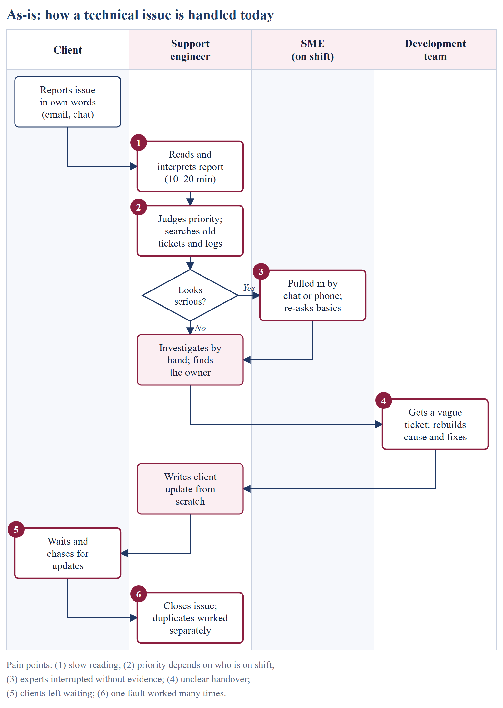
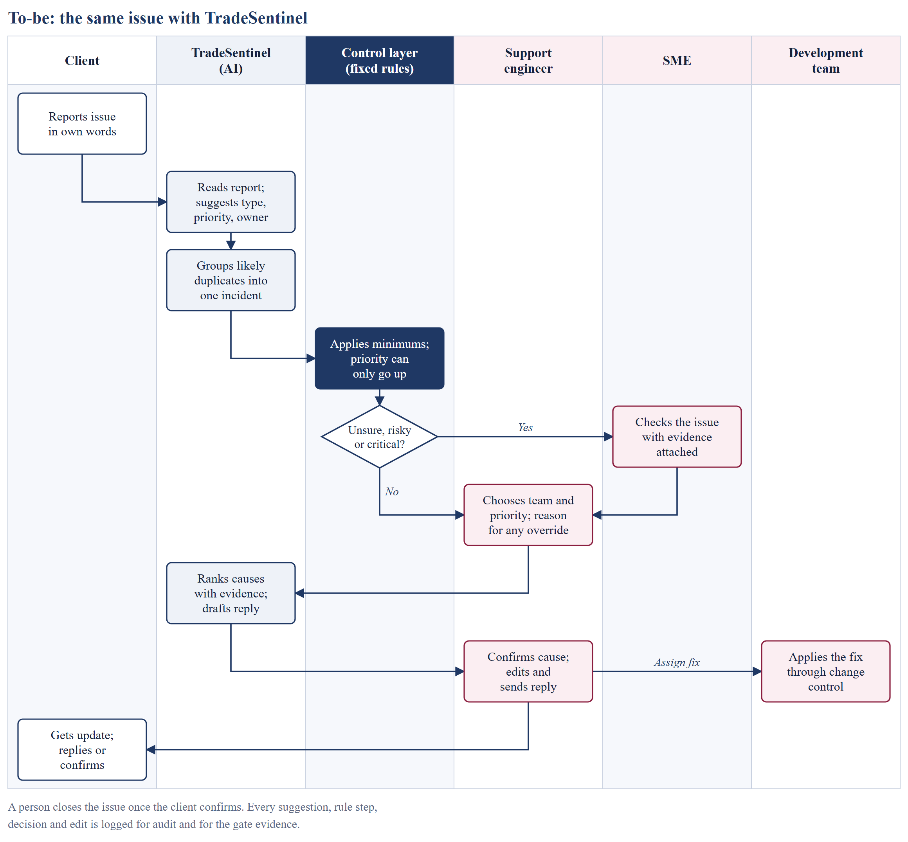
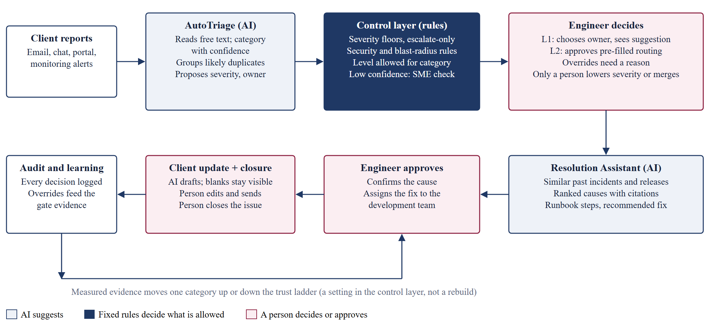
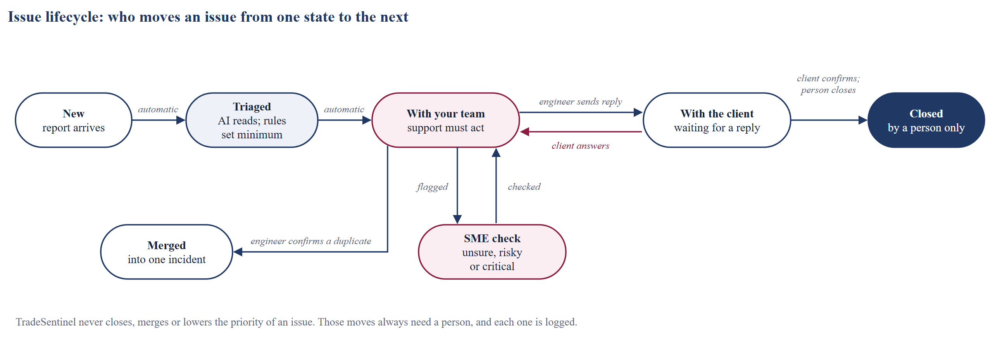
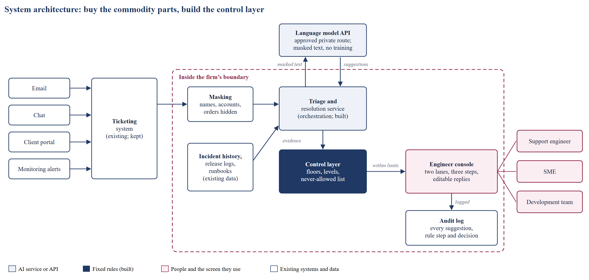

# Process and System Diagrams on TradeSentinel

*Team013 (Individual) · Jodhdeep Singh · 2025mb26112 · MBA – AI in Business · Management of AI Products · November 2026*

Five diagrams describe how TradeSentinel works. Blue boxes are AI suggestions, dark blue boxes are fixed rules, and pink boxes are people. The same diagrams appear in the Final Report.

### 1. As-is swimlane: how an issue is handled today

*One engineer reads, sizes, routes, investigates and writes every update by hand. Numbered boxes mark the six pain points.*

### 2. To-be swimlane: the same issue with TradeSentinel

*The AI reads and drafts, fixed rules set the minimum priority and decide when an SME checks, and people make every decision that matters.*

### 3. Decision workflow

*The full loop from report to closure, and how measured evidence moves a category up or down the trust ladder.*

### 4. Issue lifecycle

*Where an issue can be and who moves it. Only a person can merge or close an issue.*

### 5. System architecture

*Commodity parts are bought or called by API; the control layer, console and audit log are built. Client data is masked inside the firm before any model call.*
