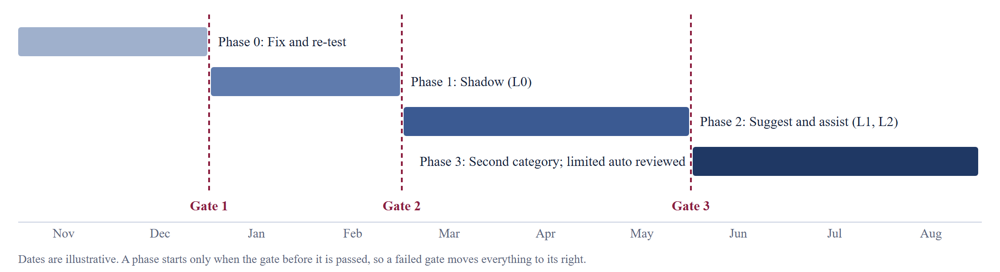

# Roadmap with Proof Gates on TradeSentinel

*Team013 (Individual) · Jodhdeep Singh · 2025mb26112 · MBA – AI in Business · Management of AI Products · November 2026*

This roadmap is about staged learning. Each phase exists to answer a question, and dates are illustrative because a failed gate moves everything after it.

*Illustrative timeline. Gate 1 needs Phase 0 to finish.*

## Phases

| Phase | Question it answers | Scope | Autonomy | Main outputs |
|---|---|---|---|---|
| 0. Fix and re-test (Nov to Dec 2026) | Can we close the understated-report gap? Does the design save time? | Synthetic data; fresh test set by a second author; timed trial with five engineers | None | Gate 1 evidence; API route chosen |
| 1. Shadow (Jan to Feb 2027) | Does it work on real tickets, for all client groups? | One flow, tier and venue; masked data; expert labels; incident replay; fairness and injection tests | L0 | Gate 2 evidence; real critical share; human baseline |
| 2. Suggest and assist (Mar to May 2027) | Do engineers use it well? Is net payoff positive? | L1 first; L2 only per category after review; execution failures stay L1 | L1, then L2 | Gate 3 evidence; sign-offs |
| 3. Second category (Jun to Aug 2027) | Is the design reusable? Should anything be automated? | Market data feed alerts, starting at L0; formal review of L3 for lowest-risk categories | L0 for new; L3 reviewed | Scale or assist-only decision |

## Gate Criteria and Stop Conditions

| Gate | Pass requires | If failed |
|---|---|---|
| Gate 1 | New held-out set: no critical issue below the escalation line; cause in top three at least 70%. Timed trial: under 3 minutes median to first correct triage | Fix and repeat once. If it fails again, return to the design or stop |
| Gate 2 | Category agreement within 5 points of expert-to-expert agreement; no S1 called below S2; no critical issue below the escalation line, including replay; no material fairness gap; masking verified | Stay in shadow. Two consecutive failures: stop or limit to search support |
| Gate 3 | Positive net payoff against current practice; ECE below 0.05; stable override and review time; SME share within the agreed ceiling; operations and risk sign-off | Stay at L1 as an assist feature |
| Reuse decision | Second category live with only small pluggable strategies added; if passed, prepare the business case for a SaaS offer | Stay a single-flow feature, not a platform or product |

## Ladder Rules

- Levels are set per category, never globally.
- A category drops a level at once on any safety breach; going back up requires passing the gate again.
- Execution failures do not go above L1 in this roadmap.
- L3 covers reversible actions on low-risk categories only.
