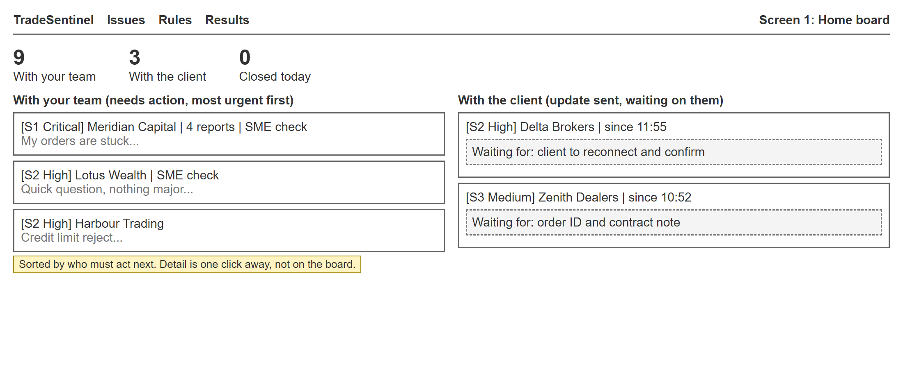
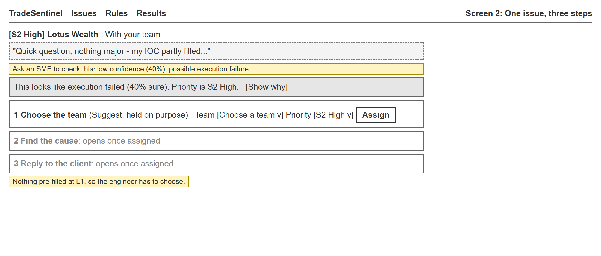
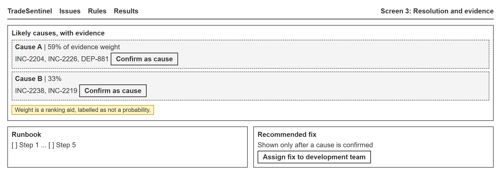
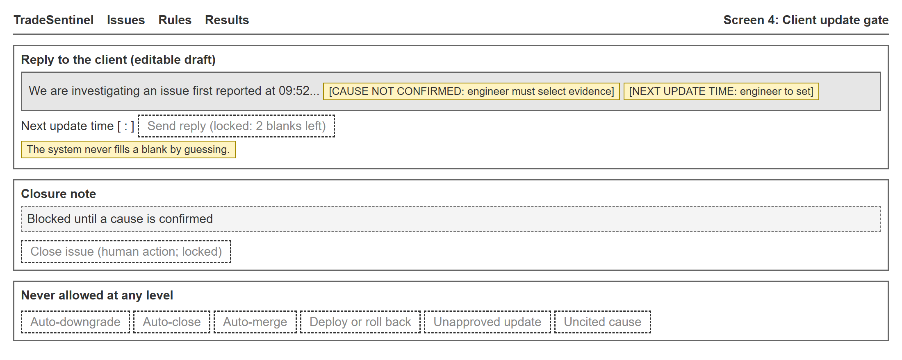

# Wireframes on TradeSentinel

*Team013 (Individual) · Jodhdeep Singh · 2025mb26112 · MBA – AI in Business · Management of AI Products · November 2026*

Low-fidelity layouts for the four moments where trust is won or lost. The yellow notes record the design decision on each screen. Screenshots of the built version are in Screenshots_or_Video.

### Screen 1: Home board with two lanes

*Issues are split by who must act next. The board shows only priority, client, a line of text and what is awaited.*

### Screen 2: One issue, three steps

*Doubt is stated in one sentence, with the reasons behind a toggle. Nothing is pre-filled at L1, which slows the engineer down on purpose.*

### Screen 3: Resolution with evidence

*Causes carry citations. The fix appears only after a person confirms a cause.*

### Screen 4: Client update gate

*Blanks are shown and block sending. Actions that are never allowed are shown as such.*
