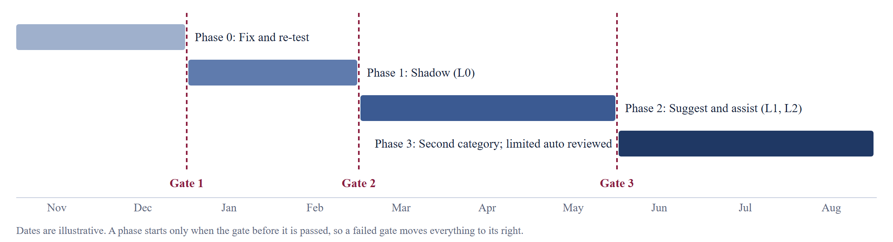

# 3.4 Smallest Credible MVP Definition & Staged Roadmap with Proof Gates

*TradeSentinel · Section 3: Product Management (PM) Artifact Pack*

**MVP.** One flow, in which a person can see the AI’s reading, see why severity was set, make the decision, and get evidence-backed resolution help up to an approved client update. The MVP has succeeded if it answers three questions: Does the AI read reports better than rules? Do the controls catch what the AI misses? Does an engineer understand and trust the decision trail? The prototype addresses the first two on synthetic data; the third needs real users.

**Trust ladder.** L0 Shadow (runs silently), L1 Suggest (shows suggestions; person decides), L2 Assisted (pre-fills for one-click approval), L3 Limited auto (low-risk, reversible actions only). Levels are set per category and must be earned.

*Figure 1. Each phase is entered only by passing a gate. Full gate criteria are in Appendix/Roadmap.*

| Phase | Question it answers | Autonomy | Gate to leave |
|---|---|---|---|
| 0. Fix and re-test (Nov to Dec 2026) | Can we close the understated-report gap? Does the design save time? | None | Gate 1 |
| 1. Shadow (Jan to Feb 2027) | Does it work on real tickets, for all client groups? | L0 | Gate 2 |
| 2. Suggest and assist (Mar to May 2027) | Do engineers use it well? Is net payoff positive? | L1, then L2 | Gate 3 |
| 3. Second category (Jun to Aug 2027) | Is the design reusable? Should anything be automated? | L0 for new; L3 reviewed | Reuse decision |

---

[← 3.3 Product Requirements Document (PRD) Summary](3.3%20Product%20Requirements%20Document%20%28PRD%29%20Summary.md) · [Contents](../README.md) · [3.5 Success Metrics & KPIs Framework →](3.5%20Success%20Metrics%20%26%20KPIs%20Framework.md)
