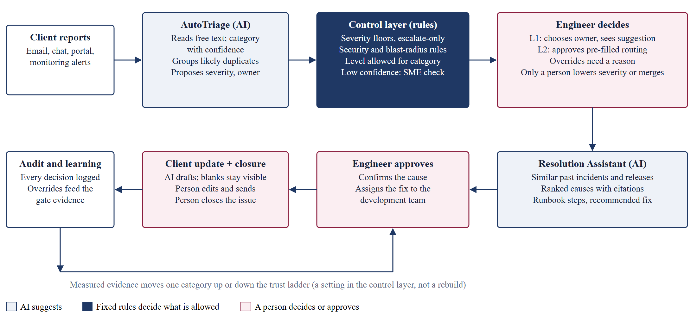

# 4.2 End-to-End User Journey & Workflow Comparison (As-Is vs. To-Be)

*TradeSentinel · Section 4: UX, Workflow & Trust Design*

*Figure 2. The AI reads and matches, rules set the limits, and a person makes every decision that matters.*

| Step | As-is (today) | To-be (with TradeSentinel) |
|---|---|---|
| Intake | Email, chat, portal and alerts arrive separately | One queue; each report read on arrival |
| Understand | Engineer reads and interprets each report | AI proposes the category with confidence and alternatives |
| Size | Priority depends on who is on shift | Model proposal, then floors, security and blast-radius rules; priority can only rise |
| Duplicates | Same fault opened and worked many times | Likely duplicates grouped; a person confirms the merge |
| Route | Engineer finds the owner | Owner suggested (L1) or pre-filled (L2); unclear or risky issues go to an SME |
| Investigate | Search logs, releases and old tickets by hand | Causes ranked with cited incidents and releases |
| Fix | Depends on the engineer’s memory | Checklist and suggested fix; fix assigned to the development team |
| Update client | Written from scratch under pressure | Editable draft; Send locked while blanks remain |
| Wait and close | Waiting issues get lost among active ones | Separate client lane; a person closes with a cited note |

---

[← 4.1 Core UX Principle - A Review Copilot, Never an Autonomous Controller](4.1%20Core%20UX%20Principle%20-%20A%20Review%20Copilot%2C%20Never%20an%20Autonomous%20Controller.md) · [Contents](../README.md) · [4.3 Annotated Wireframe & Screen Architecture →](4.3%20Annotated%20Wireframe%20%26%20Screen%20Architecture.md)
