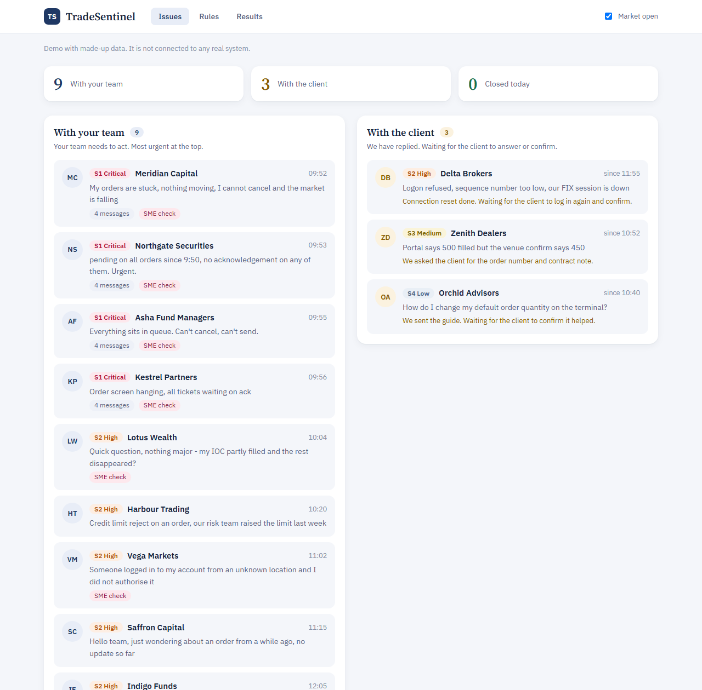
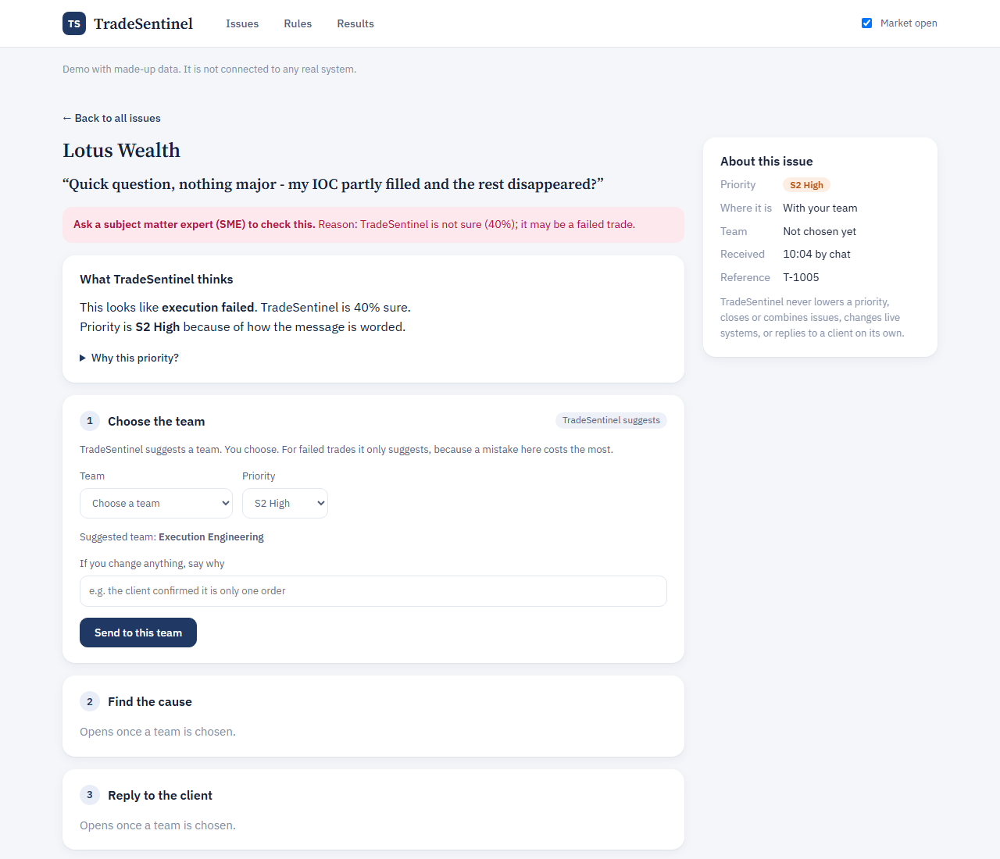

# 4.3 Annotated Wireframe & Screen Architecture

*TradeSentinel · Section 4: UX, Workflow & Trust Design*

| Screen | Purpose | Main elements |
|---|---|---|
| Top bar | Navigation and context | Issues, Rules and Results tabs; Market open switch |
| Issues board | Who must act next? | Three counts; lanes “With your team” and “With the client”; Try your own message; Closed today |
| Issue page | Decide on one issue | Step 1 Choose the team; Step 2 Find the cause; Step 3 Reply to the client; side card “About this issue” with “Why this priority?” and history |
| Rules | Set automation per category | Level per category; execution failures locked at L1; paper reuse test |
| Results | Show the evidence | Evaluation results, where it went wrong, money view by approach |

Low-fidelity wireframes with design notes are in Appendix/Wireframes. The screens below come from the working prototype, simplified after the first version proved too crowded.

**Home board.** *With your team* holds issues that need support action, most urgent first. *With the client* holds issues where an update has gone out and the client must reply or confirm, each showing what is awaited and since when. Issues that need expert judgment are flagged “SME check”.

*Figure 3. Home board. The four linked stuck-order reports lead the team lane at S1; three issues wait on clients.*

*Figure 4. “Quick question, nothing major”: one issue, three steps. Low confidence asks an SME to check, and with execution failures held at L1 nothing is pre-filled.*

---

[← 4.2 End-to-End User Journey & Workflow Comparison (As-Is vs. To-Be)](4.2%20End-to-End%20User%20Journey%20%26%20Workflow%20Comparison%20%28As-Is%20vs.%20To-Be%29.md) · [Contents](../README.md) · [4.4 Trust, Explainability, and Information Hierarchy (Visible vs. Hidden) →](4.4%20Trust%2C%20Explainability%2C%20and%20Information%20Hierarchy%20%28Visible%20vs.%20Hidden%29.md)
