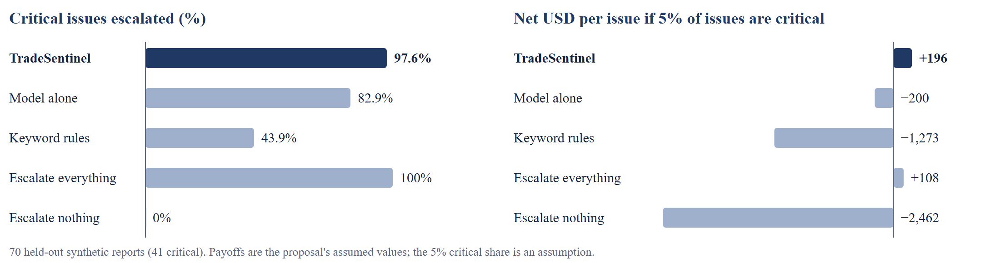

# 5.5 Evaluation Framework and Results

*TradeSentinel · Section 5: Data, Model & Evaluation Strategy*

Settings were tuned on a 20-report development set, then frozen. The 70-report holdout set, which includes deliberately understated, polite and very short reports, was run once on those frozen settings. Results below are reproducible with *node evaluate.js holdout*. Holdout results were not used for tuning.

| Metric type | Metric | Result (holdout) | Baseline or target | Why it matters |
|---|---|---|---|---|
| Technical | Category accuracy | 90% (63 of 70) | Keyword rules 45.7% | Wrong category means wrong owner and wrong floor |
| Technical | Macro F1 | 0.899 | Keyword rules 0.486 | Guards against a strong category hiding a weak one |
| Technical | Calibration error (ECE) | 0.083 | Lower is better | L2 depends on confidence meaning something |
| Technical | Duplicate pairs: precision / recall | 100% / 100% | High | Likely flattered by clean time bursts in our data |
| Technical | True cause in top 3 / top 1 | 96.8% / 80.6% | At least 70% in top hypotheses | Likely flattered: same author wrote incidents and tests |
| Trust | Critical issues escalated | 97.6% (40 of 41) | Model alone 82.9% | 95% interval is 87.4% to 99.6%; sample is small |
| Trust | Under-triaged critical issues | 3 (1 fell below escalation) | Near zero | **Target not met** |
| Trust | Wrong category sent to SME check | 5 of 7 | All | Two errors passed at high confidence |
| Trust | Guardrail invariants | 5 of 5 held | All, on every ticket | Severity never lowered; no unapproved or uncited send |
| Business | Net payoff per issue, 5% critical | +196 USD | Model alone −200 | Assumed payoffs, measured error rates |
| Business | Time to first correct triage | Not measured | Under 3 minutes | Needs real users; no value claimed |

*Figure 5. The control layer raises critical-issue escalation and turns a losing payoff into a positive one.*

**What the comparison shows.** At the assumed payoffs, the model alone loses money because each extra miss is so expensive: it missed seven critical issues where TradeSentinel missed one. Escalating everything is a surprisingly strong competitor when critical issues are common (+365 against +378 USD at a 10% share), but far worse when they are rare (−98 against +50 at 1%). The real critical share is therefore a number the pilot must measure.

**Where it failed.**

| Report | Truth | System | Reading |
|---|---|---|---|
| “Not urgent, but my limit order that should have traded at the touch shows nothing done.” | S2 | S3 | The most serious failure. Polite framing and thin vocabulary produced a wrong category at 82% confidence, so neither floors nor the SME check fired. |
| “All sessions dropped at 9:15 for our firm, can't reconnect.” | S1 | S2 | Escalated, but below critical: only three reports had arrived, one short of the blast-radius rule. |
| “Gateway unreachable, market is open and we are blind.” | S1 | S2 | Same cluster, same reason. |

Very short messages can also score high confidence on little evidence: “Getting error 2047 when I enter” receives 95% in the demo. Two proposed fixes follow, neither yet applied or tested: a rule that sends any report mentioning an order with no visible outcome to the execution floor, and a confidence cap on reports with few recognised terms. They need a *new* held-out set, because the current one has now been seen.

**How far to trust these numbers.** One author wrote the training data, test data and incident catalogue, so the shared vocabulary probably flatters every figure, and the 100% clustering result should not be taken at face value. What the evaluation can show is that the logic works and where it breaks. It cannot show how the system performs on real tickets.

---

[← 5.4 Baseline and Model Choice](5.4%20Baseline%20and%20Model%20Choice.md) · [Contents](../README.md) · [5.6 Launch Thresholds and Gate Status →](5.6%20Launch%20Thresholds%20and%20Gate%20Status.md)
