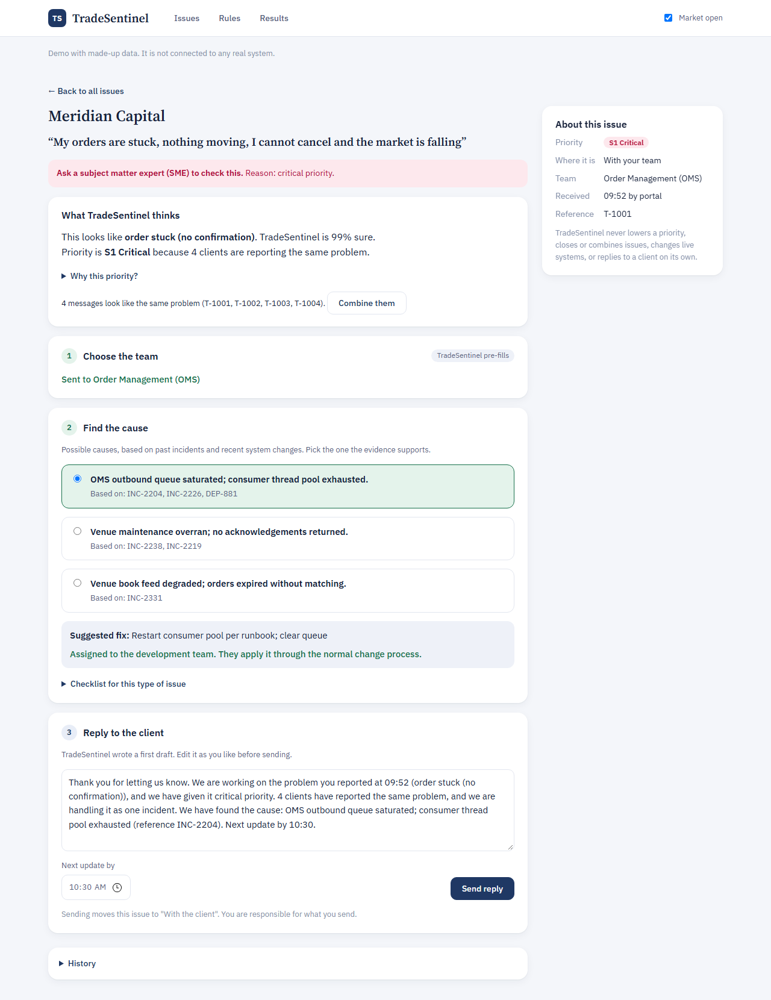

# 8.1 Prototype Overview

*TradeSentinel · Section 8: Prototype & MVP*

| Item | Detail |
|---|---|
| Prototype type | Working web app in one HTML file, running locally in the browser with no server or API key. |
| What it demonstrates | The whole decision loop for one flow: triage with confidence, duplicates, severity with floors, L1 and L2 routing with execution failures held at L1, override with reason, evidence-based causes, checklist, and client update through to closure. Issues move between two lanes, with your team and with the client, as updates go out and replies come back. The suggested reply can be edited before sending, and suggested fixes are assigned to the development team. |
| AI role | A real statistical classifier and retrieval run live; any report typed in is triaged on the spot. Templates stand in for language model drafting. |
| Decision logic | Changing a category’s level or the market-hours toggle changes behaviour immediately, showing that autonomy is configuration and not a rebuild. |
| What it does not yet prove | Language model quality; performance on real tickets; time saved; engineer trust; integration; scale; regulatory acceptance. It uses no real data. Send actions are simulated. |
| Links | Live demo: https://jodhdeep10.github.io/tradesentinel-console/ Repository: https://github.com/jodhdeep10/tradesentinel-console Setup and walkthrough: 04_Prototype_Readme_or_Link.md. Screenshots: Appendix/Screenshots_or_Video. |

*Figure 6. Resolution: each cause cites past incidents and releases, the fix is assigned to the development team, and sending the reply, which the engineer can edit, moves the issue to the client lane.*

---

[← 7.4 Launch Blockers](../07.Ethics%2C%20Governance%20%26%20Risk/7.4%20Launch%20Blockers.md) · [Contents](../README.md) · [8.2 Reuse Test - Market Data Feed Delay Alerts →](8.2%20Reuse%20Test%20-%20Market%20Data%20Feed%20Delay%20Alerts.md)
